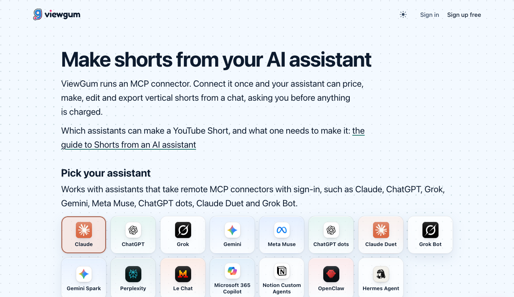

# ViewGum skills for AI agents

Agent skills and an MCP connector for vertical short video, for Claude Code, Codex, Gemini CLI and other agents that read skills.

| Skill | What it teaches the agent | Needs |
|---|---|---|
| [`viewgum-shorts`](skills/viewgum-shorts/SKILL.md) | Make, edit and export finished vertical shorts through ViewGum's connector: price first, ask before any paid step, wait for the short to finish, edit by plain words or exact timeline changes, export the MP4 with post copy for each app | The connector, a paid ViewGum plan and credits |
| [`short-form-specs`](skills/short-form-specs/SKILL.md) | Safe zones in pixels for TikTok, YouTube Shorts, Instagram Reels and Facebook Reels, length and caption limits, and how many words fit a length, for any 9:16 video the agent is building (Remotion, HyperFrames, ffmpeg or an editor) | Nothing |
| [`hook-check`](skills/hook-check/SKILL.md) | Grade the opening line of a short on five criteria from an open benchmark rubric plus two counted checks, then write three better hooks | Nothing |
| [`short-form-script`](skills/short-form-script/SKILL.md) | Write or fix a voiceover script sized to a length, with on-screen text and a visual for every line, self-checked for length, a fast start, short sentences and unsourced figures | Nothing |
| [`post-copy`](skills/post-copy/SKILL.md) | Titles, captions and hashtags for each app from what the video says, every field counted against the app's published limit | Nothing |
| [`upload-preflight`](skills/upload-preflight/SKILL.md) | Check a rendered file against each app's published upload limits with [shortform-preflight](https://github.com/viewgum/shortform-preflight) and give the FFmpeg fix for each failure | FFmpeg |
| [`ai-label-check`](skills/ai-label-check/SKILL.md) | Whether a video made with AI needs an AI label on TikTok, YouTube, Instagram and Facebook, from each app's published rule, with the setting to use | Nothing |

The figures in `short-form-specs` come from [viewgum/short-form-video-specs](https://github.com/viewgum/short-form-video-specs),
where each one has its source and the date it was read.

## Install

### Claude Code

The plugin adds the connector and both skills:

```sh
claude plugin marketplace add viewgum/skills
claude plugin install viewgum@viewgum
```

Then run `/mcp` in Claude Code and sign in to ViewGum. The skills show as `/viewgum:viewgum-shorts` and
`/viewgum:short-form-specs`.

### Skills only

For agents the [skills CLI](https://github.com/vercel-labs/skills) supports:

```sh
npx skills add viewgum/skills
```

Add `--skill short-form-specs` for just the specs. `viewgum-shorts` also needs the connector, below.

### Codex CLI

```sh
codex mcp add viewgum --url https://viewgum.com/mcp
codex mcp login viewgum
npx skills add viewgum/skills
```

### Gemini CLI

For Gemini CLI with a Gemini API key or an existing Code Assist plan. Google moved free and consumer users to Antigravity CLI on
June 18, 2026 ([Google's notice](https://developers.googleblog.com/an-important-update-transitioning-gemini-cli-to-antigravity-cli/));
Antigravity's steps are on [viewgum.com/agents](https://viewgum.com/agents).

```sh
gemini extensions install https://github.com/viewgum/skills
```

Then run `/mcp auth viewgum` to sign in.

### Claude, ChatGPT, Grok, Gemini, Antigravity, Cursor, VS Code and others

The connector's address is `https://viewgum.com/mcp`. Steps for each assistant are on [viewgum.com/agents](https://viewgum.com/agents).



### From a terminal

Open ViewGum's Make stage with an idea filled in, or add the connector to an agent, with no install:

```sh
npx -y github:viewgum/skills make "How a hippo holds its breath" --look build3d
npx -y github:viewgum/skills connect codex
```

`connect` prints the steps for claude, codex, gemini, cursor or vscode; add `--run` to run the claude or codex commands.

## Try it

With `viewgum-shorts` and the connector:

- "Make a 3D Build short about how a suspension bridge goes up. Show me the price first."
- "Turn this into a 30 second Explainer: why do cats knead?"
- "Change the caption word 'its' to 'it's' and trim the first second."
- "Export it and give me the TikTok caption."

With `short-form-specs`, in a video project:

- "Place the title in this Remotion composition where TikTok and Shorts won't cover it."
- "How many words fit a 45 second voiceover?"

## How charging works

The connector never charges without a quote. `quote_short`, `quote_edit` and `quote_export` return a price and a `quote_id`;
nothing is charged until `make_short`, `edit_short` or `export_short` runs with that id, and the same id never charges twice.
When a make is quoted as a range, `make_short` holds the top of the range and charges what the make took, so the top is the most
it can cost. The skill tells the agent to show the price and wait for a yes. Asking for an edit quote saves the request and the plan in the short's chat; the edit
itself waits for `edit_short`.

Reading shorts and credits, exact timeline edits (`propose_edits`, `apply_edit_session`) and checking an export are free on any
account with access; prices, makes, chat edits and exports need a paid plan. New connections start with a daily credit cap,
which the account owner can change or remove in ViewGum's settings. Plans and credits: [viewgum.com/pricing](https://viewgum.com/pricing).

## What the connector does

| Step | Tools |
|---|---|
| Account | `get_credits`, `list_formats`, `list_shorts` |
| Make | `quote_short`, `make_short`, `get_short` |
| Change by asking | `quote_edit`, `edit_short` |
| Exact timeline changes, free | `get_short_view`, `list_capabilities`, `propose_edits`, `apply_edit_session`, `discard_edit_session`, `undo_edit`, `set_caption_words` |
| Export | `quote_export`, `export_short`, `check_export` |
| Brand kits | `list_kits`, `save_kit` |

[`mcp/tools.json`](mcp/tools.json) lists each tool with the description the server gives agents. Sign-in is OAuth, and the
connector acts only as the person who signed in.

## Repository layout

| Path | For |
|---|---|
| `skills/` | The skills, one folder each, read by `npx skills` and by every plugin below |
| `.claude-plugin/`, `.mcp.json` | Claude Code plugin and marketplace |
| `plugin.json`, `mcp.json` | [Agent Plugins](https://agent-plugins.org) manifest, for agents that read it |
| `gemini-extension.json` | Gemini CLI extension |
| `mcp/tools.json` | The connector's tools, from its public server card |
| `examples/` | Real, dated runs of the skills, one file each |
| `bin/viewgum.mjs` | The `make` and `connect` commands above |

`npm test` checks the skills and manifests offline. `npm run check-live` compares `viewgum-shorts` and `mcp/tools.json` with what
viewgum.com serves now, and the reference files with the specs repository.

## Privacy and terms

Using the connector means signing in to ViewGum, under its [terms](https://viewgum.com/terms) and
[privacy policy](https://viewgum.com/privacy). The `short-form-specs` reference files can be read offline; the optional `npx`
commands download tools, and the skills CLI has its own telemetry setting.

## License

MIT. The JSON files in `skills/short-form-specs/references/` are CC BY 4.0, credit "ViewGum, viewgum.com". See [LICENSE](LICENSE).
